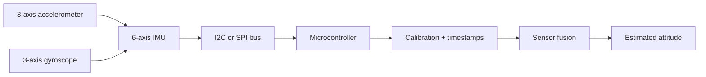

---
aliases:
  - 6-Axis IMU
  - Six Degree of Freedom IMU
  - Six-axis Inertial Measurement Unit
tags:
  - electronics/imu
  - sensors
---

# 6-DoF IMU

## What is an IMU?

An **inertial measurement unit (IMU)** combines motion sensors in one module or package. A typical **6-axis (often called 6-DoF) IMU** has:

- **3-axis [[Gyroscope]]:** $\omega_x,\omega_y,\omega_z$ (angular rates).
- **3-axis [[Accelerometer]]:** $a_x,a_y,a_z$ (specific-force readings).

The common example [[BMI088 - Hardware Connection|Bosch BMI088]] combines separate 16-bit, three-axis gyroscope and accelerometer sensing blocks in one package.

## Data path

Each sensing block delivers **raw digital readings**, which a microcontroller reads, converts to physical units, and combines. An ordinary BMI088 is **not** a plug-and-play source of absolute Euler angles; the host generally performs orientation estimation.

## Six axes vs. observable motion

A rigid body has six kinematic degrees of freedom (three translation and three rotation), but **six IMU channels do not make position or absolute heading directly measurable**:

- Gyroscope integration tracks short-term changes in all three rotational axes.
- Under low linear acceleration, gravity gives **roll and pitch** reference information.
- **Yaw around gravity is unobservable from gyro + accelerometer alone**, so it remains relative and can drift.
- Position/velocity obtained through acceleration integration rapidly accumulate error without external aiding.

A **magnetometer**, GNSS, camera, external tracking system, or system-specific constraints can add reference information. A nine-axis IMU usually adds a three-axis magnetometer, but magnetic interference must then be handled.

## Digital connection to a microcontroller

Two common choices:

| Feature | I²C | SPI |
|---|---|---|
| Typical signal wires | SDA + SCL (plus power/ground) | SCK + MOSI + MISO + chip-select(s) (plus power/ground) |
| Device selection | 7-bit addresses | Active-low chip-select lines |
| Wiring | Fewer signal wires; shared bus | More wires; often useful for faster data reads |
| Practical detail | Needs SDA/SCL pull-up resistors | Requires correct mode/timing and chip-select behavior |

**For BMI088 specifically**, the accelerometer and gyro act as **two separately addressed I²C endpoints** or **two separately selected SPI endpoints**. See [[BMI088 - Hardware Connection]] for the *actual chip pins*.

## A reliable firmware pipeline

1. Configure power, interface mode, measurement range, and output data rate.
2. Verify communications and enable both sensor blocks.
3. Acquire **time-stamped** accelerometer and gyroscope samples.
4. Convert raw numbers to $\mathrm{m/s^2}$ and $\mathrm{rad/s}$ using the configured sensitivity.
5. Apply axis alignment and [[Gyroscope#Basic stationary calibration|gyro]] / [[Accelerometer#Calibration basics|accelerometer]] calibration.
6. Use [[Sensor Fusion and Filtering]] to estimate orientation, starting with a [[Complementary Filter]] or using a [[Kalman Filter for IMUs]] for bias/uncertainty estimation.

> [!tip] Time matters
> Data rates and read times can differ between the accelerometer and gyroscope. Do not assume two values read back-to-back represent the **same instant**; use data-ready interrupts, sensor timestamps, or carefully controlled timing when appropriate.

See also: [[IMU Notes]] · [[BMI088 - Hardware Connection]]

## Sources

- [Bosch Sensortec — BMI088 product page](https://www.bosch-sensortec.com/en/products/motion-sensors/imus/bmi088)
- [NXP Sensor Fusion overview](https://www.nxp.com/company/about-nxp/smarter-world-blog/BL-SENSOR-FUSION)