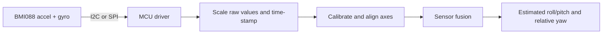

---
aliases:
  - BMI088
  - Bosch BMI088 Wiring
  - BMI088 Interfacing
tags:
  - electronics/imu
  - sensors/bmi088
  - embedded/i2c
  - embedded/spi
---

# BMI088 — Hardware Connection

## What is the BMI088?

The **Bosch Sensortec BMI088** is a **6-axis IMU** containing one **three-axis 16-bit accelerometer** and one **three-axis 16-bit gyroscope** in a single IC. It is targeted at vibration-prone applications including drones and robotics.

- Acceleration ranges: **±3, ±6, ±12, ±24 g**.
- Gyroscope ranges: **±125, ±250, ±500, ±1000, ±2000 °/s**.
- Digital interfaces: **I²C or SPI**.
- **VDD: 2.4–3.6 V**; **VDDIO: 1.2–3.6 V**. A common straightforward setup uses **3.3 V for both** with a 3.3 V microcontroller.

> [!warning] This table is for the bare BMI088 IC
> Breakout board pin names/positions may differ. Check the **exact board schematic** before wiring. Do not connect a bare BMI088 directly to 5 V power or 5 V logic. The breakout may or may not include a regulator/level shifter.

## Connection option A: I²C

The accelerometer and gyroscope share **SCL/SDA** but behave like **two I²C targets with separate addresses**.

| BMI088 IC pin | Name | Connect to |
|---|---|---|
| 3 | VDD | 3.3 V supply (within 2.4–3.6 V) |
| 11 | VDDIO | MCU-compatible I/O supply, e.g. 3.3 V |
| 4, 6 | GNDA, GNDIO | Common ground |
| 8 | SCL/SCK | MCU I²C SCL |
| 9 | SDA/SDI | MCU I²C SDA |
| 7 | PS | Tie to VDDIO (selects gyro I²C) |
| 14 | CSB1 | VDDIO or leave unconnected per datasheet; **tie high** for a defined I²C setup |
| 5 | CSB2 | Leave unconnected (DNC) for I²C |
| 15 | SDO1 | GND = accel address `0x18`, VDDIO = `0x19` |
| 10 | SDO2 | GND = gyro address `0x68`, VDDIO = `0x69` |
| 2 | NC | Connect to GND in Bosch's reference circuit |
| 1, 12, 13, 16 | Interrupt pins | Optional, leave unconnected if unused |

- Add suitable **SDA/SCL pull-ups to VDDIO** (e.g. 4.7 kΩ as a starting design value for a short, low-capacitance 3.3 V bus; actual value depends on bus capacitance and speed).
- The BMI088 supports standard/fast-mode I²C **up to 400 kHz**.
- Place **100 nF decoupling capacitors** close to each of VDD and VDDIO, as shown in the Bosch connection drawing.

### Example scan result (SDO1=GND, SDO2=GND)

```text
Found I2C target at 0x18   # Accelerometer
Found I2C target at 0x68   # Gyroscope
```

These are **7-bit addresses**; don't shift them unless the chosen MCU library explicitly expects an 8-bit read/write address.

## Connection option B: four-wire SPI

Here the two sensor blocks use **separate active-low chip selects**, with SCK and MOSI shared. Their SDO outputs can share the MCU's MISO line if the CS signals are controlled correctly.

| BMI088 IC pin | Name | Connect to |
|---|---|---|
| 3, 11 | VDD, VDDIO | Appropriate supplies, e.g. 3.3 V each |
| 4, 6 | GNDA, GNDIO | Common ground |
| 7 | PS | GND (selects gyro SPI) |
| 8 | SCL/SCK | MCU SPI SCK |
| 9 | SDA/SDI | MCU SPI MOSI |
| 15 | SDO1 | MCU SPI MISO (accel output) |
| 10 | SDO2 | Same MCU SPI MISO (gyro output) |
| 14 | CSB1 | MCU GPIO: **accelerometer CS** |
| 5 | CSB2 | Another MCU GPIO: **gyroscope CS** |
| 2 | NC | GND per Bosch reference circuit |
| 1, 12, 13, 16 | Interrupt pins | Optional; leave unconnected if unused |

**Crucial BMI088 SPI quirks:**

1. The **accelerometer starts in I²C mode after power-up**. To enter SPI mode, perform a **dummy SPI read** with `CSB1` so it experiences the required rising edge. Discard the data from that first access.
2. An **accelerometer SPI read returns a dummy byte before the requested data**; ignore that dummy byte. The gyro SPI interface does *not* have this extra read dummy byte.
3. Keep the unselected chip's CS high. Use Bosch's documented SPI mode, clock rate, and transaction timing.
4. Use the same local decoupling and voltage precautions as in the I²C setup.

## Firmware startup checklist

1. Wire the selected bus, supply, ground, and protocol-select pins correctly.
2. Apply power; allow initialization to settle.
3. On **SPI**, perform the accelerometer's required dummy access to switch modes.
4. Verify both sensing blocks by reading their **separate chip-ID registers** (rather than expecting one combined IMU endpoint).
5. The **gyro starts in normal mode**, but the **accelerometer starts suspended** after power-on reset.
6. For the accelerometer: after power-up, **wait at least 1 ms**, write **`0x04` to `ACC_PWR_CTRL` (`0x7D`)**, then **wait at least 450 µs** before treating its output as active (see datasheet initialization sequence).
7. Set accelerometer/gyro range, bandwidth, and output data rate appropriate for the application.
8. Read and decode both sensors' axes; apply sensitivity factors for the configured ranges.
9. Time-stamp and align the two sample streams. Optionally use data-ready interrupts / on-chip timing features for improved synchronization.
10. Calibrate; then feed the data to a [[Complementary Filter]] or [[Kalman Filter for IMUs]].

## What happens after connection?



The hardware delivers the two sets of motion measurements. It does **not** remove all gyro drift or automatically provide a fully referenced orientation; see [[Gyroscope]], [[Accelerometer]], and [[Sensor Fusion and Filtering]].

## Troubleshooting

| Symptom | First things to check |
|---|---|
| Only one I²C address responds | Both target addresses; SDO1/SDO2 address strap levels; PS and CSB1; pull-ups |
| Gyro responds, accel readings missing | Accelerometer still suspended; SPI interface switch not performed; wrong CS |
| SPI accel reads appear byte-shifted | Missing/discarding the accelerometer's read dummy byte |
| Readings have wrong scale | Selected ±g/±°/s range, signed int16 conversion, and units |
| Orientation slowly walks while motionless | Gyro offset, temperature effects, timestamp accuracy, fusion configuration |
| Wild tilt while accelerating | Accelerometer senses linear acceleration as well as gravity |

## Primary references

- [Bosch Sensortec — BMI088 datasheet, rev. 1.9 (January 2024)](https://www.bosch-sensortec.com/media/boschsensortec/downloads/datasheets/bst-bmi088-ds001.pdf) — sections 3, 6, and 7 cover initialization, buses, pin-out and connection drawings.
- [Bosch Sensortec — BMI088 product page](https://www.bosch-sensortec.com/en/products/motion-sensors/imus/bmi088)
- [Bosch Sensortec — BMI08x design guide](https://community.bosch-sensortec.com/knowledge-base-pg631enp/post/bmi08x-design-guide-ZWU1wwmHYnSw68r)