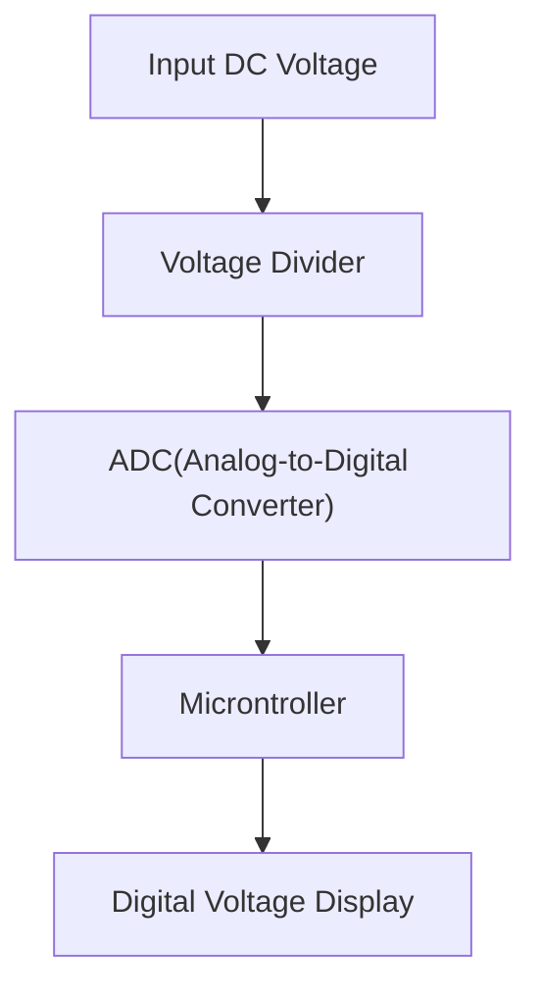

## 1. AIM 

To design and build a digital voltmeter using a voltage sensor (or voltage divider) and an Analog-to-Digital Converter (ADC) to measure and display voltage.

## 2. What is a Voltmeter
A voltmeter is an electronic instrument used to measure the potential difference (voltage) between two points in an electrical circuit .

A digital voltmeter converts analog voltage into digital value that can be displayed on screen.

## 3. Components Required 

| Component       | Function                                      |
| --------------- | --------------------------------------------- |
| Voltage Divider | Reduce the input voltage to a safe level      |
| ADC             | Converts analog voltage into digital volatage |
| Resistors       | Used to construct the voltage divider         |

## 4. Block Diagram

## 5. Working Principle 

* The input voltage is connected to the voltage sensor or voltage divider 
* The voltage divider reduces the voltage to a safe range for the ADC
* The ADC converts the analog voltage into a digital number 
* The microcontroller reads the digital value
* The microcontroller calculates the original input voltage 

## 6.  Voltage Divider

A voltage divider consists of two resisters connected in series.

![[voltage_divider.jpg]]

The output is calculated using:
$$
\boldsymbol V_{out} = \mathbf V_{in} \times \frac{\boldsymbol R_{2}}{\mathbf R_1 +\mathbf R_2}
$$
Where:
* $V_{in}$ = input voltage
* $V_{out}$ = voltage sent to the ADC
* $R_1$ = upper resistor
* $R_2$ = lower resistor

For example, using $R_{1} = 30k\Omega$ and $R_{2} = 7.5k\Omega$
$$
V_{out} = V_{in} \times 0.2
$$
Therefore, when the input voltage is 20V:
$$
V_{out} = 20 \times 0.2 = 4V
$$
This is suitable for 5V ADC input, provided the input voltage does not exceed 25V.

## 7 Analog-to-Digital Converter (ADC)
An ADC converts to a continuous analog voltage into a digital number.

For a 10-bit ADC:
$$
2^{10} = 1024\space \space levels
$$
The digital readings range from 0 to 1023.

For an ideal 10-bit ADC using 5V reference, the approximate ADC input voltage is:
$$
V_{ADC} = \frac{\boldsymbol ADC reading \times 5}{\mathbf 1023}
$$

The original input voltage can be calculated as:
$$
V_{in} = V_{ADC} \times \frac{R_{1} + R_{2}}{R_{2}}
$$

For the resistor values above:
$$
V_{in} = \frac{ADC reading \times 5}{1023} \times 5
$$

## 8 Applications
Digital voltmeters using ADCs are used in battery monitoring systems, power supplies etc. I use this in my flight controller for a model rocket (ongoing).