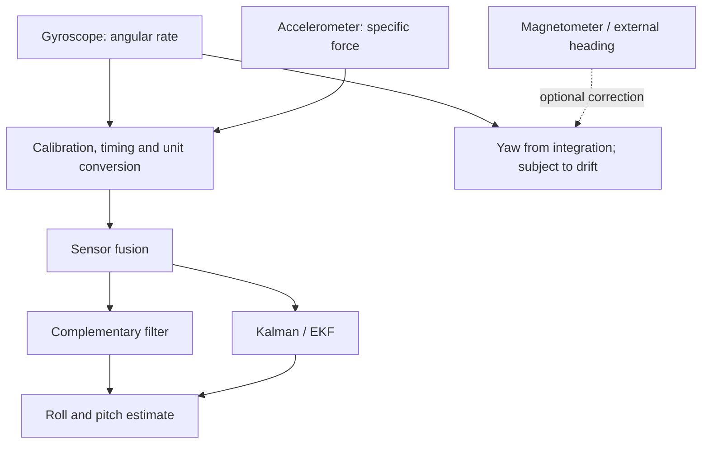

aliases:
  - IMU Notes
  - Inertial Sensing Map of Content
tags:
  - electronics/imu
  - moc
---

# IMU Notes — Index

> [!summary] Key idea
> A 6-axis IMU measures **angular velocity** and **specific force**, not a perfectly stable absolute orientation. The sensors have complementary error characteristics, so [[Sensor Fusion and Filtering|sensor fusion]] is needed for useful roll/pitch estimation over time.

## Learning path

1. [[Gyroscope]] — what angular-rate measurements mean, calibration, bias, noise, and **integration drift**.
2. [[Accelerometer]] — specific force, gravity-based tilt, vibration, bias, and linear-acceleration interference.
3. [[6-DoF IMU]] — how three axes of each sensor form a 6-axis inertial measurement unit.
4. [[Sensor Fusion and Filtering]] — why neither sensor alone produces a reliable long-term attitude estimate.
5. [[Complementary Filter]] — a simple practical roll/pitch filter.
6. [[Kalman Filter for IMUs]] — a model-based filter that can estimate both attitude and gyro bias.
7. [[BMI088 - Hardware Connection]] — wiring and initializing a real 6-axis IMU using I²C or SPI.

## Data flow

## Quick comparison

| Measurement | Strength | Weakness | Role in fusion |
|---|---|---|---|
| Gyroscope | Fast response to rotation | Bias causes integrated angle drift | Short-term orientation changes |
| Accelerometer | Gravity direction available when translation is negligible | Vibrations and linear acceleration look like changes in tilt | Long-term roll/pitch reference |
| 6-axis IMU | Both measurements in one system | No absolute heading reference | Estimates roll and pitch; yaw remains relative |

> [!important] Terminology
> **6-DoF / 6-axis IMU** usually means 3 gyroscope + 3 accelerometer channels. It does **not** imply that absolute position and all three orientation angles are independently observable.

## Practical pipeline

`BMI088 → I²C/SPI → raw samples → time stamps → calibration → physical units → complementary/Kalman fusion → estimated orientation`

## References

- [Bosch Sensortec — BMI088 product information](https://www.bosch-sensortec.com/en/products/motion-sensors/imus/bmi088)
- [MathWorks — Determine Orientation Using Inertial Sensors](https://www.mathworks.com/help/fusion/gs/determine-orientation-through-sensor-fusion.html)
- [NXP — What is Sensor Fusion?](https://www.nxp.com/company/about-nxp/smarter-world-blog/BL-SENSOR-FUSION)