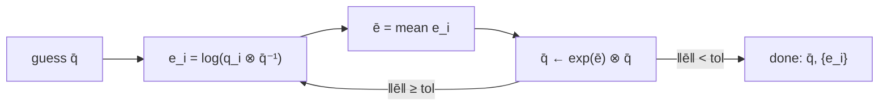

# Quaternion Averaging

## Why not just average the numbers?
1. The arithmetic mean of unit quaternions isn't a unit quaternion.
2. Double cover: $q$ and $-q$ are the same rotation but average to **0**.
3. Even after normalising, it's not the rotation that minimises the squared rotation errors.

## Gradient-descent (intrinsic) mean
Find $\bar q$ that minimises $\sum_i \lVert\log(q_i\otimes\bar q^{-1})\rVert^2$. Kraft's iteration:

```
q̄ ← initial guess           (e.g. previous estimate propagated by ω·dt)
repeat:
    e_i  = log(q_i ⊗ q̄⁻¹)      for every sigma point     (error rotation vectors)
    ē    = mean(e_i)
    q̄    ← exp(ē) ⊗ q̄
until ‖ē‖ < tol   (or max iterations)
```
At convergence, the final $\mathbf e_i$ are exactly the orientation part of the error vectors $\mathcal W'_i$ used for the covariance — no extra work needed.



**Convergence:** sigma points are close together (a few degrees), so it's nearly linear and converges in 2–4 iterations from a good guess. A good guess matters: the original started from the first sigma point (already offset by a whole σ) and had no iteration cap. → [[Code Review - Bugs and Fixes#7. Quaternion-mean loop|bug #7]]

## Alternative: eigenvector method (Markley 2007)
$$M = \sum_i w_i\, q_i q_i^T \ (4\times4), \qquad \bar q = \text{eigenvector of } M \text{ with the largest eigenvalue}$$
Closed form, sign-invariant (since $qq^T = (-q)(-q)^T$), minimises a chordal rather than geodesic distance. Nearly identical for tightly clustered points. Handy for a quick sanity check:
```python
M = (w[:, None, None] * qs[:, :, None] * qs[:, None, :]).sum(0)
q_bar = np.linalg.eigh(M)[1][:, -1]
```

Next: [[Quaternion UKF (Kraft)]]
