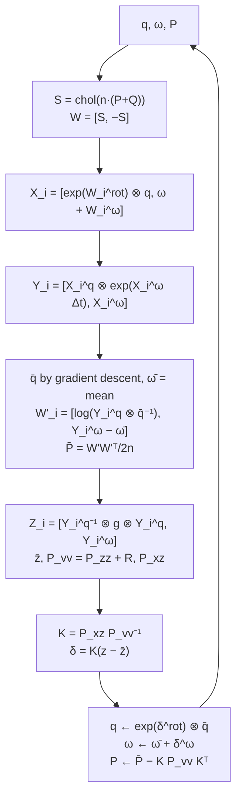

# Quaternion UKF (Kraft)

> E. Kraft, *"A Quaternion-based Unscented Kalman Filter for Orientation Tracking,"* Proc. 6th Int. Conf. on Information Fusion, 2003.

## The problem
The state contains a unit [[Quaternions|quaternion]]. You can't:
- add a Gaussian offset to it (it leaves the unit sphere),
- average it as a vector ([[Quaternion Averaging]]),
- subtract two of them to get an error.

## The fix: 7-D state, 6-D uncertainty
| | Dim | Lives in |
|---|---|---|
| State $x = [q,\ \boldsymbol\omega]$ | 7 | $S^3\times\mathbb R^3$ |
| Error / covariance $P$ | 6 | $\mathbb R^3\times\mathbb R^3$ (rotation vector + ω error) |
| Sigma points | 2·6 = 12 | state space |
| Measurement $z = [\mathbf a,\ \boldsymbol\omega_{gyro}]$ | 6 | $\mathbb R^6$ |

Every place a vector filter would use $+$ or $-$ on the quaternion uses ⊞ / ⊟ instead. → [[Exponential and Log Maps]]

| Vector UKF | Quaternion UKF |
|---|---|
| $\chi_i = \hat x \pm S_i$ | $q_i = \exp(S_i^{rot})\otimes\hat q$ |
| $\bar x = \sum W_i\mathcal Y_i$ | gradient-descent mean $\bar q$ |
| $\mathcal Y_i - \bar x$ | $\log(\mathcal Y^q_i\otimes\bar q^{-1})$ |
| $\hat x = \bar x + K\nu$ | $\hat q = \exp\big((K\nu)^{rot}\big)\otimes\bar q$ |

## Models
**Process** (constant angular velocity over Δt):
$$q_{k+1} = q_k\otimes\exp(\boldsymbol\omega_k\Delta t),\qquad \boldsymbol\omega_{k+1} = \boldsymbol\omega_k$$
**Measurement** ([[IMU Sensor Models]]):
$$\mathbf a = q^{-1}\otimes(0,\ \mathbf g)\otimes q \quad(\text{gravity in body frame}),\qquad \boldsymbol\omega_{gyro} = \boldsymbol\omega$$

## Left vs right errors
There are two consistent conventions. Pick one for **all** of sigma points, error vectors and update:

| | Left (global / world-frame) | Right (local / body-frame) |
|---|---|---|
| ⊞ | $\exp(\delta)\otimes q$ | $q\otimes\exp(\delta)$ |
| ⊟ | $\log(q_1\otimes q_2^{-1})$ | $\log(q_2^{-1}\otimes q_1)$ |
| Yaw error is | always the world-z component | depends on attitude |

With **left** errors, yaw (rotation about gravity) is always the 3rd component, so the filter can keep a large, growing yaw variance while roll/pitch stay tight — exactly what the covariance plot in [[Results#Dataset 1]] shows.

> [!bug] Kraft's paper (and the original code) mixes the two
> Sigma points use right ⊞, errors and update use left ⊟/⊞. Fixing it cuts total error by 35–55% with tuned noise. → [[Code Review - Bugs and Fixes#1. Sigma points and error vectors in different frames|bug #1]]

## One step

Code: [[Filter Pipeline (Code Walkthrough)]].

## Known limitations of this formulation
- **No bias states:** gyro bias must be calibrated beforehand. Adding $\mathbf b_g$ to the state (9-D error) would let the filter track slow drift.
- **Accelerometer = gravity:** linear acceleration is treated as noise. Fast manoeuvres → raise `r_accel` or gate on $\big|\lVert\mathbf a\rVert - g\big|$.
- **Yaw unobservable:** needs a magnetometer or vision. → [[IMU Sensor Models#Observability]]
- **Q per step:** depends on IMU rate; `scale_q_by_dt` makes it a per-second rate.

Related: [[Unscented Kalman Filter]] · [[Quaternion Averaging]] · [[Tuning Guide]]
