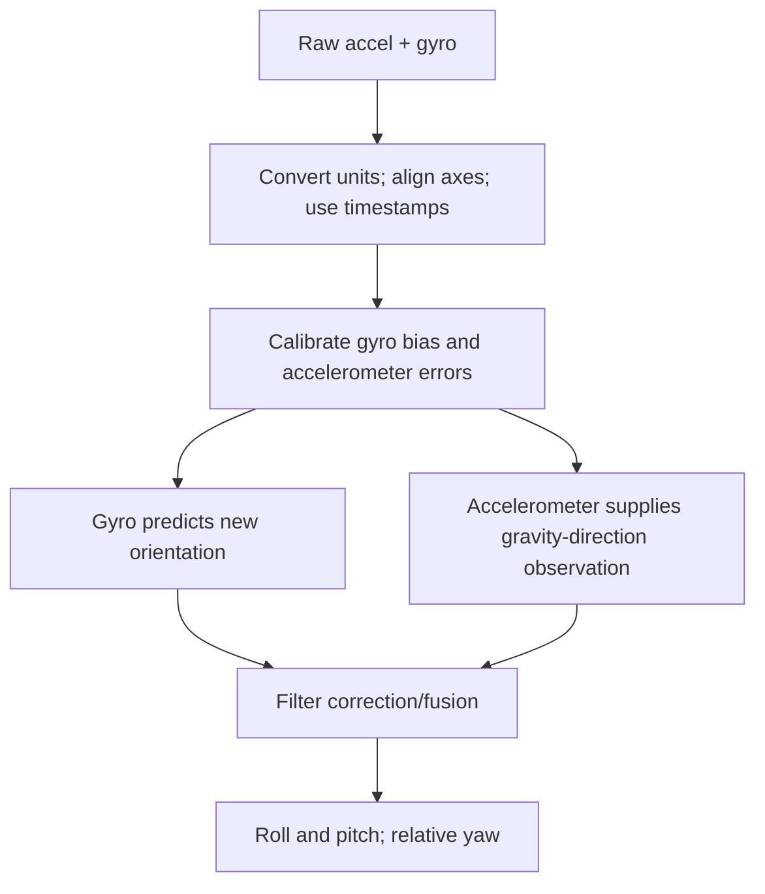

---
aliases:
  - Why IMU Filtering Is Necessary
  - Sensor Fusion
  - IMU Filtering
tags:
  - electronics/imu
  - signal-processing/sensor-fusion
---

# Sensor Fusion and Filtering

## Why is filtering necessary?

A [[6-DoF IMU]] provides two different, imperfect ways to estimate orientation:

- The [[Gyroscope]] measures angular velocity. Integrating it produces smooth, responsive short-term orientation changes, but even a small **rate bias accumulates as angle drift**.
- The [[Accelerometer]] measures specific force. When gravitational acceleration is the dominant reference, it provides an absolute **tilt direction** for roll/pitch, but **linear motion and vibration contaminate** this estimate.

The goal of **sensor fusion** is not merely smoothing noisy data: it is combining measurements that contain **different information and different error mechanisms**.

> [!example] Mental model
> Use the gyroscope to answer **"How did the orientation change just now?"** and the accelerometer to answer **"Which way is down, on average?"**. Neither sensor alone answers both reliably.

## Why a low-pass filter alone is insufficient

A low-pass filter on raw accelerometer data reduces high-frequency noise, but it **cannot distinguish sustained linear acceleration from a real change in gravity direction**. Similarly, low-pass filtering gyro rates does **not correct a steady bias**; integrating a biased rate still drifts.

Therefore, a useful attitude filter usually includes:

1. A **prediction** from the gyro's measured rotation over $\Delta t$.
2. A **correction** based on the accelerometer's measured gravity direction, only to the extent that this measurement is trustworthy.

## Typical strategies

| Technique | Basic idea | Advantages | Limitations |
|---|---|---|---|
| [[Complementary Filter]] | Give gyro and accelerometer different frequency-domain roles | Simple, efficient, few parameters | Basic versions need hand-tuned gains and motion safeguards |
| [[Kalman Filter for IMUs]] | Predict a state and correct it using noise/uncertainty models | Can estimate bias, track uncertainty, extend to other sensors | More tuning, modeling, implementation effort |

For a 6-axis IMU, **both approaches usually correct roll/pitch drift with gravity**. Neither can create an absolute yaw measurement out of gravity alone.

## What should be filtered, and when?

## Important real-world failure cases

- **Motor vibrations:** may produce large oscillatory acceleration; choose sample rates, bandwidths, and anti-aliasing appropriately.
- **Sustained translation:** accelerometer cannot be treated as a clean gravity reference; a filter may need to reduce its correction weight.
- **Temperature change:** gyro bias shifts after startup; re-estimate/model it when practical.
- **Incorrect sample timing:** using the wrong $\Delta t$ creates a systematic integration error.
- **Coordinate confusion:** sensor axes, body axes, and world axes must be clearly defined.
- **Missing yaw reference:** heading drift will remain even with an excellent roll/pitch filter.

## Practical conclusion

Start with a calibrated [[BMI088 - Hardware Connection|BMI088]], consistent timing, and the [[Complementary Filter]]. Move to [[Kalman Filter for IMUs|Kalman/EKF-style filtering]] when you need explicit gyro-bias estimation, uncertainty handling, additional sensors, or more complicated 3D motion.

See also: [[Gyroscope]] · [[Accelerometer]] · [[6-DoF IMU]]

## Sources

- [MathWorks — Determine Orientation Using Inertial Sensors](https://www.mathworks.com/help/fusion/gs/determine-orientation-through-sensor-fusion.html)
- [MathWorks — Choose Inertial Sensor Fusion Filters](https://www.mathworks.com/help/fusion/ug/introduction-on-choosing-inertial-sensor-fusion-filters.html)
- [NXP — What is Sensor Fusion?](https://www.nxp.com/company/about-nxp/smarter-world-blog/BL-SENSOR-FUSION)