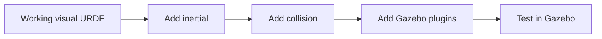
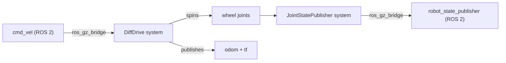

# URDF - Gazebo Simulation

Previous: [[URDF - Visualization]]

This is pass 2 of writing a URDF. It assumes the robot already looks right in RViz. If it doesn't, go back to [[URDF - Visualization]] first. The inertia macros below are written in xacro, which is covered in the [[URDF - Visualization#Improving a URDF with xacro (XML macros)|xacro section]] of that note.



---

## Pass 2: Simulation

### Adapting the URDF for Gazebo

In order to simulate the robot in Gazebo, you need to add two key elements: **inertial** and **collision** properties. We add these with the `<inertial>` and `<collision>` tags.

### Inertial tag

It contains a few elements, including the 3x3 matrix representing an inertia tensor. Inside the inertial tag we need the following:

1. **Mass** of the element (in kg).
2. **The origin for the inertia** (in meters and radians). This is related to the component itself, so you can use the same value you used for the visual origin.
3. **The nine elements of the inertia tensor.** Since the matrix is symmetric we only need 6 of the 9: `ixx`, `ixy`, `ixz`, `iyy`, `iyz`, and `izz`.

$$
I = \begin{bmatrix}
i_{xx} & i_{xy} & i_{xz} \\
i_{xy} & i_{yy} & i_{yz} \\
i_{xz} & i_{yz} & i_{zz}
\end{bmatrix}
$$

For simple shapes centered on their origin, the off-diagonal terms (`ixy`, `ixz`, `iyz`) are 0.

These are some common inertial tags defined in an xacro macro.

**Box:**

```xml
<xacro:macro name="box_inertia" params="m x y z o_xyz o_rpy">
    <inertial>
        <mass value="${m}" />
        <origin xyz="${o_xyz}" rpy="${o_rpy}" />
        <inertia ixx="${(m/12) * (z*z + y*y)}" ixy="0" ixz="0"
                 iyy="${(m/12) * (x*x + z*z)}" iyz="0"
                 izz="${(m/12) * (x*x + y*y)}" />
    </inertial>
</xacro:macro>
```

**Cylinder:**

```xml
<xacro:macro name="cylinder_inertia" params="m r l o_xyz o_rpy">
    <inertial>
        <mass value="${m}" />
        <origin xyz="${o_xyz}" rpy="${o_rpy}" />
        <inertia ixx="${(m/12) * (3*r*r + l*l)}" ixy="0" ixz="0"
                 iyy="${(m/12) * (3*r*r + l*l)}" iyz="0"
                 izz="${(m/2) * (r*r)}" />
    </inertial>
</xacro:macro>
```

**Sphere:**

```xml
<xacro:macro name="sphere_inertia" params="m r o_xyz o_rpy">
    <inertial>
        <mass value="${m}" />
        <origin xyz="${o_xyz}" rpy="${o_rpy}" />
        <inertia ixx="${(2/5) * m * r * r}" ixy="0" ixz="0"
                 iyy="${(2/5) * m * r * r}" iyz="0"
                 izz="${(2/5) * m * r * r}" />
    </inertial>
</xacro:macro>
```

These come from the formulas on this page: [List of moments of inertia](https://en.wikipedia.org/wiki/List_of_moments_of_inertia)

> [!warning]
> The cylinder formula assumes the cylinder's length runs along z. For the wheel, the visual is rolled by `pi/2`, so the inertial origin needs the **same** `rpy`. This is exactly why using the visual origin for the inertia origin works.

You call these inside a link, just like the wheel macro:

```xml
<xacro:cylinder_inertia m="0.5" r="${wheel_radius}" l="0.045"
                        o_xyz="0 0 0" o_rpy="${pi/2.0} 0 0"/>
```

> [!tip]
> - Use realistic masses. A mass or inertia of zero (or something tiny) makes the simulation unstable and the robot can jitter or fly off.
> - KDL (used by `robot_state_publisher`) doesn't support inertia on the root link. That's why most robots have an empty `base_footprint` link (no inertial) as the root, attached to `base_link` with a fixed joint.

### Collision tag

It defines the shape Gazebo uses to work out when the link touches something. The robot will fall through the ground, for example, without a collision tag.

Inside the collision tag we define something similar to what we have in the visual tag. As a general rule, we use simpler shapes than for the visual (if possible). This is because more complex shapes require more computation to calculate the collision between the link and other elements.

```xml
<collision>
    <geometry>
        <cylinder radius="${wheel_radius}" length="0.045"/>
    </geometry>
    <origin xyz="0 0 0" rpy="${pi/2.0} 0 0"/>
</collision>
```

> [!tip]
> A caster should roll freely, so give it zero friction. Otherwise it drags and the robot struggles to turn:
> ```xml
> <gazebo reference="caster_link">
>     <mu1>0.0</mu1>
>     <mu2>0.0</mu2>
> </gazebo>
> ```

---

## Simulating hardware components

To make the robot do something useful in Gazebo, we simulate hardware components such as LiDAR, cameras, etc.

To do that we use **systems** (plugins). For a differential drive robot, for example, you will simulate a system for the differential drive (two parallel wheels). You would probably also need a system to publish the joint states.



Gazebo topics aren't ROS 2 topics, so you need `ros_gz_bridge` to pass messages between the two.

You need to search through the Gazebo systems page on GitHub:

<https://github.com/gazebosim/gz-sim/tree/gz-sim8/src/systems>

> [!note]
> `gz-sim8` is the branch for Gazebo Harmonic. Pick the branch that matches the Gazebo version you have installed, because plugin options can change between versions.

For example, find the `diff_drive` folder to see what you need in order to use the diff_drive controller. This is what it looks like:

```xml
<gazebo>
    <plugin
        filename="gz-sim-diff-drive-system"
        name="gz::sim::systems::DiffDrive">
        <left_joint>left_wheel_joint</left_joint>
        <right_joint>right_wheel_joint</right_joint>
        <frame_id>odom</frame_id>
        <child_frame_id>base_footprint</child_frame_id>
        <wheel_separation>${wheel_separation}</wheel_separation>
        <wheel_radius>${wheel_radius}</wheel_radius>
    </plugin>

    <plugin
        filename="gz-sim-joint-state-publisher-system"
        name="gz::sim::systems::JointStatePublisher">
    </plugin>
</gazebo>
```

> [!warning]
> - The joint names have to match **exactly** what's in your URDF. The wheel macro in [[URDF - Visualization]] creates `left_wheel_joint` and `right_wheel_joint`.
> - Use the xacro properties for `wheel_separation` and `wheel_radius` instead of typing numbers. If they don't match the real geometry, the odometry will drift.
> - Unless you set a `<topic>`, DiffDrive listens on `/model/<robot_name>/cmd_vel`.

---

## Simulation checklist

- [ ] Every simulated link has `<collision>` and `<inertial>` with realistic values
- [ ] Cylinder visuals, collisions and inertias all use the same rotation
- [ ] The root link (`base_footprint`) has no inertial
- [ ] Caster friction is zero
- [ ] Joint names in plugins match the URDF exactly
- [ ] `wheel_separation` and `wheel_radius` in the plugin match the geometry
- [ ] `ros_gz_bridge` is set up for `cmd_vel`, `odom`, `tf` and joint states
