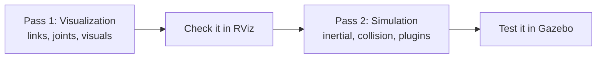
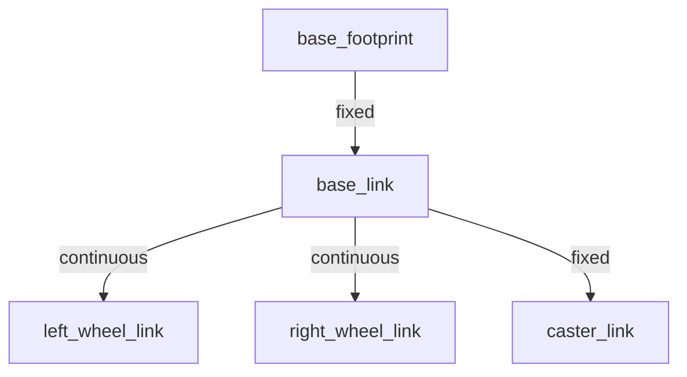
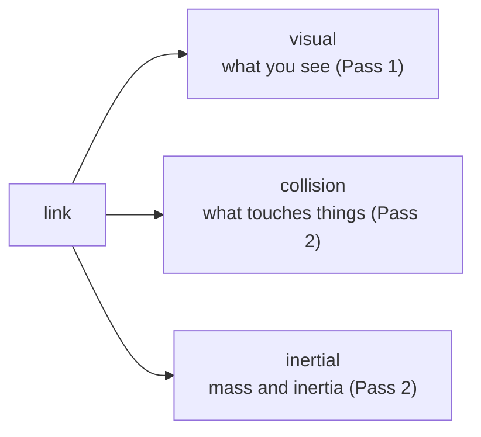
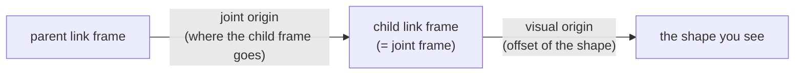
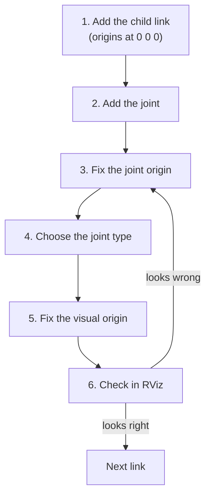

# URDF - Visualization

Next: [[URDF - Gazebo Simulation]]

URDF (Unified Robot Description Format) is a file that contains a description of all the elements of a robot. It's written in XML (it consists of tags, similar to HTML).

The minimum code needed in a URDF is:

```xml
<?xml version="1.0"?>
<robot name="my_robot">
    <!-- robot description goes here -->
</robot>
```

> [!note]
> This is just the skeleton. To actually load, a URDF needs at least one `<link>` inside the `<robot>` tag. If you use xacro (see below), name the file `my_robot.urdf.xacro`.

I've found that the cleanest way to write a URDF file is to go in two passes:



This note covers pass 1. Pass 2 is in [[URDF - Gazebo Simulation]].

---

## Pass 1: Visualization

Getting the visuals of the URDF right consists primarily of two components. These are the main parts of a robot model.

### The robot is a tree

Before writing anything, it helps to sketch the robot as a tree. Links are the boxes and joints are the arrows. Every link (except the root) has exactly **one** parent, and there can't be any loops.



### Link

A link is essentially a rigid body in your visualization. For example, a wheel represented by a cylinder. There are three different shapes you can use:

| Shape    | What's needed      | Example                                  |
| -------- | ------------------ | ---------------------------------------- |
| box      | x, y, z sizes      | `<box size="0.6 0.4 0.2"/>`              |
| cylinder | radius and length  | `<cylinder radius="0.1" length="0.045"/>` |
| sphere   | radius             | `<sphere radius="0.05"/>`                |

> [!tip]
> A cylinder's length always runs along the link's **z axis**. That's why a wheel needs rotating (see the wheel macro below). You can also use a `<mesh filename="..."/>` to load an STL or DAE file if you want a custom shape.

A link can hold three things. You only need the first one for Pass 1:



### Joint

As the name suggests, joints connect rigid bodies and also define how they move relative to each other. The most common movements are:

- **Fixed**: The two parts aren't moving relative to each other.
- **Revolute**: A rotation that has a min and max angle. E.g. a robotic arm.
- **Continuous**: An infinite rotation, good for wheels.
- **Prismatic**: Makes a part slide (only translation, no rotation).

There are also `floating` and `planar` joints, but you'll rarely need them.

> [!important]
> Every joint except `fixed` needs an `<axis xyz="..."/>` tag to say which axis it moves around (or along). `revolute` and `prismatic` joints also need a `<limit>` tag:
> ```xml
> <axis xyz="0 0 1"/>
> <limit lower="-1.57" upper="1.57" effort="10" velocity="1.0"/>
> ```
> For revolute joints `lower` and `upper` are in radians. For prismatic joints they're in meters.

### Coordinate frames

ROS uses this convention:

- **x** points forward, **y** points left, **z** points up.
- `rpy` is roll (around x), pitch (around y) and yaw (around z), all in **radians**.

The thing that confused me most at first is that there are two different origins. The joint origin says *where the child link's frame sits* relative to the parent link. The visual origin says *where the shape sits inside its own link's frame*.



### Putting together a link

Inside the link, use the `<visual>` tag:

- Define the geometry you want using the `<geometry>` tag.
- Define the origin of the visual using the `<origin>` tag. This is relative to the link's own frame, which is placed by the joint that connects it to its parent.
- Use the `<material>` tag to change the material of the link (mostly colors, and opacity defined by alpha).

This is an example:

```xml
<link name="caster_link">
    <visual>
        <geometry>
            <!-- <sphere radius="0.035"/> -->
            <sphere radius="${wheel_radius / 2.0}"/>
        </geometry>
        <material name="dark"/>
    </visual>
</link>
```

### Putting together a joint

1. `<parent>` tag: This is the parent link. Put the exact name of the parent.
2. `<child>` tag: Put the exact name of the child link.
3. `<origin>` tag: This defines the origin of the child link relative to the origin of the parent.

This is an example:

```xml
<joint name="caster_joint" type="fixed">
    <parent link="base_link"/>
    <child link="caster_link"/>
    <origin xyz="-0.15 0 ${-wheel_radius / 2.0}" rpy="0 0 0"/>
</joint>
```

> [!note]
> This works out nicely if `base_link`'s origin is at the height of the wheel axles. The wheels touch the ground at `z = -wheel_radius`. The caster's center is at `-wheel_radius/2` and its radius is `wheel_radius/2`, so its bottom also lands at `z = -wheel_radius`. All three touch the ground.

The `<origin>` tag is used in both the link and the joint for different purposes, but it takes the same parameters: `xyz` for translation and `rpy` for rotation.

---

## Assembling links and joints

To assemble links and joints, it is best to follow this process:



**Step 1: Add the second link.**
Of course this assumes you have assembled the base link. At this point, we can leave the `xyz` and `rpy` as `"0 0 0"` for the origin tag.

**Step 2: Add a joint.**
I've shown an example of what this looks like above.

**Step 3: Fix the origins.**
You need to now modify the origin. The most important thing to do here is fix the *joint* origin. So, modify `xyz` and `rpy` appropriately relative to the origin of the parent link. A good rule of thumb is to put the joint where the part actually pivots, e.g. the center of a wheel's axle.

**Step 4: Choose the joint type.**
I've discussed the common joint types above. Remember to add an `<axis>` (and a `<limit>` if needed).

**Step 5: Fix the visual origin.**
Now we can fix the visual origin. You can modify the `<origin>` tag inside the child link tag appropriately. For a wheel, the joint is already at the center, so the visual origin only needs a rotation.

**Step 6: Check it.**
Load the robot in RViz with `robot_state_publisher` and `joint_state_publisher_gui`. The GUI gives you sliders to move each joint, which is the fastest way to spot a wrong axis or origin.

---

## Improving a URDF with xacro (XML macros)

We already used xacro in the snippets above: anything inside `${...}` is xacro. For it to work, the `<robot>` tag needs the xacro namespace:

```xml
<robot name="my_robot" xmlns:xacro="http://www.ros.org/wiki/xacro">
```

### Materials

The snippets above assumed we have a `dark` material. This is actually plain URDF, not xacro. You define the material once at the top level (inside `<robot>` but outside any link), and then any link can use it by name:

```xml
<material name="dark"><color rgba="0.12 0.14 0.18 1"/></material>
```

### Properties

A **property** is basically a named constant. This is where `wheel_radius` and `wheel_separation` come from:

```xml
<xacro:property name="wheel_radius" value="0.1"/>
<xacro:property name="wheel_separation" value="0.45"/>
```

Change it in one place and every link that uses it updates. `pi` is built in, so you don't have to define it.

### Macros

We can also have **macros**, which you can think of as functions in programming. A macro is a template for building a component, and it makes the code more reusable with different parameters. This is an example:

```xml
<xacro:macro name="wheel" params="side sign">
    <link name="${side}_wheel_link">
        <visual>
            <geometry>
                <cylinder radius="${wheel_radius}" length="0.045"/>
            </geometry>
            <origin xyz="0 0 0" rpy="${pi/2.0} 0 0"/>
            <material name="dark"/>
        </visual>
    </link>

    <joint name="${side}_wheel_joint" type="continuous">
        <parent link="base_link"/>
        <child link="${side}_wheel_link"/>
        <origin xyz="0 ${sign * wheel_separation / 2.0} 0" rpy="0 0 0"/>
        <axis xyz="0 1 0"/>
    </joint>
</xacro:macro>
```

Defining a macro doesn't add anything to the robot. You have to call it, like calling a function:

```xml
<xacro:wheel side="left"  sign="1"/>
<xacro:wheel side="right" sign="-1"/>
```

The `rpy="${pi/2.0} 0 0"` rolls the cylinder 90° so its length runs along y (sideways) instead of z (up). The `sign` puts each wheel on the correct side, since +y is to the left:

```
           Top view (looking down from above)

                       +x (forward)
                           ▲
                           │
     left wheel            │            right wheel
      ┌────┐               │               ┌────┐
      │    │───────────────●───────────────│    │
      └────┘           base_link           └────┘
   y = +sep/2              │            y = -sep/2
   (sign = 1)              │            (sign = -1)
                           │
                           ○  caster (x = -0.15)

     +y ◄──── (y points to the left)
```

### Generating and checking the URDF

Some tools need a plain URDF, so you can convert the xacro file and then check it for errors:

```bash
xacro my_robot.urdf.xacro > my_robot.urdf
check_urdf my_robot.urdf
```

You can also split a big robot into several files and pull them in with `<xacro:include filename="..."/>`. A common setup is one file for the materials, one for the inertia macros and one for the Gazebo plugins.

---

## Visualization checklist

- [ ] `<robot>` has the `xmlns:xacro` namespace
- [ ] Every property and material is defined before it's used
- [ ] Macros are actually called, not just defined
- [ ] Every non-fixed joint has an `<axis>`, and revolute or prismatic joints have a `<limit>`
- [ ] Angles are in radians
- [ ] Cylinder visuals use the rotation you expect (length along z unless rolled)
- [ ] `check_urdf` passes
- [ ] Every joint moves the right way in RViz

Once this all looks right, move on to [[URDF - Gazebo Simulation]].
