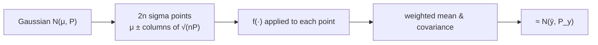

# Unscented Transform

> [!quote] Julier & Uhlmann's idea
> "It is easier to approximate a probability distribution than an arbitrary non-linear function."

Given $x\sim\mathcal N(\mu, P)$ in $n$ dimensions and a non-linear $y = f(x)$, estimate the mean and covariance of $y$.

## Recipe
1. **Choose sigma points** — a small deterministic set with the same mean and covariance as $x$.
2. **Propagate** each one through $f$ (the real non-linear function, no linearisation).
3. **Recombine** with weights to get $\bar y$ and $P_y$ (and the cross-covariance $P_{xy}$ if needed).

## Sigma points
Let $S$ be any matrix square root, $SS^T = (n+\lambda)P$, with columns $S_i$:
$$\chi_0 = \mu,\qquad \chi_i = \mu + S_i,\qquad \chi_{i+n} = \mu - S_i \qquad (i = 1\ldots n)$$
$$W_0 = \frac{\lambda}{n+\lambda},\qquad W_i = \frac{1}{2(n+\lambda)}$$
Recombine:
$$\bar y = \sum_i W_i\, f(\chi_i),\qquad P_y = \sum_i W_i\,(y_i-\bar y)(y_i-\bar y)^T,\qquad P_{xy} = \sum_i W_i\,(\chi_i-\mu)(y_i-\bar y)^T$$
The mean and covariance come out correct to 2nd order of the Taylor expansion (EKF: 1st order).

### Kraft's version (this project)
$\lambda = 0$ → no centre point, **2n points with equal weights $\frac1{2n}$**. For $n = 6$: 12 sigma points.

### Spread factor
With equal weights the sample covariance of the points is $\frac{1}{2n}\sum W_iW_i^T = SS^T/n$. To reproduce $P$ you need $SS^T = nP$:

| Option | $S$ | Points represent | Where it comes from |
|---|---|---|---|
| `standard` | $\operatorname{chol}(nP)$ | $P$ ✅ | unscented transform with κ = 0 |
| `kraft` | $\operatorname{chol}(2nP)$ | $2P$ | as printed in Kraft (2003) |
| `legacy` | $\operatorname{sqrtm}(\sqrt n\,P)$ | $P/\sqrt n \approx 0.41P$ | original `estimate_rot.py` |

Verified numerically in `ukf_core` (`kraft` → exactly 2.000 × P, `legacy` → 0.408 × P). → [[Code Review - Bugs and Fixes#3. Sigma-point spread|bug #3]]

> [!tip] Cholesky vs `sqrtm`
> Any $S$ with $SS^T = M$ is valid: the points differ but their mean and covariance are the same. Cholesky is the usual choice — fast, and it fails loudly if $M$ isn't positive definite, which is a useful warning.

## Scaled UT (for reference)
Wan & van der Merwe parameterise with $\alpha$ (spread, ~1e-3…1), $\beta$ (prior knowledge, 2 for Gaussian), $\kappa$ (often 0 or 3−n):
$$\lambda = \alpha^2(n+\kappa) - n,\qquad W_0^{(m)} = \frac{\lambda}{n+\lambda},\qquad W_0^{(c)} = W_0^{(m)} + 1 - \alpha^2 + \beta$$
Small α keeps points local (good for strongly non-linear functions); with small α, $W_0$ becomes large and negative.

## Picture

Next: [[Unscented Kalman Filter]]
