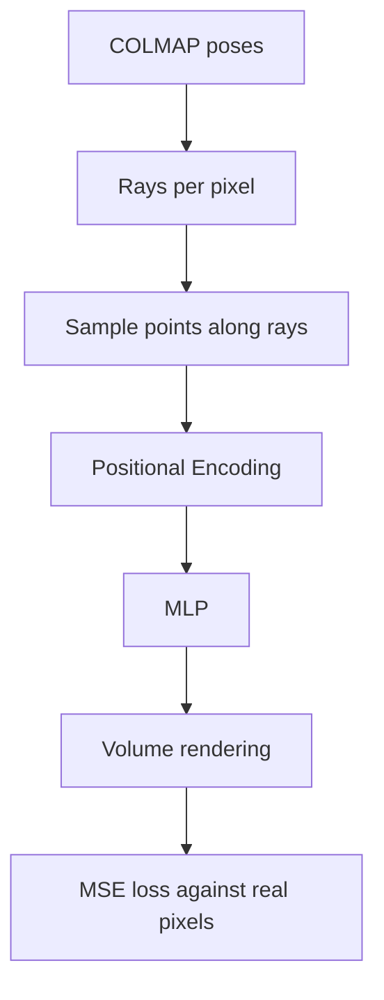

Trained a NeRF from scratch to reconstruct a 3D LEGO bulldozer scene from 100 posed 2D images. The project uses images posed with COLMAP.

### Training Samples 

![[training_samples.png]]

## 2. Data
- **Input:** `transforms_colmap.json` (from `colmap2nerf.py`) plus RGBA images, resized to **200×200** (from 800×800).
- **Intrinsics:** focal length and principal point (`cx`, `cy`) are scaled by the resize factor.
- **Background:** the alpha channel is used to composite each image onto **white**: `rgb·α + (1 − α)`.
- **Scene normalisation:** the scene centre is estimated as the least-squares point closest to every camera's viewing axis. The scene is moved so this point is at the origin and scaled so the cameras sit about **4 units** away. This keeps coordinates in the range the positional encoding is designed for.
- **Split:** every 8th image is held out for validation and never used in training.
- **Near/far bounds:** set automatically to `0.5 × min camera distance` and `1.5 × max camera distance` (about 2.0 and 6.0).

## 3. Architecture

### 3.1 Rays
For each pixel (i, j), the camera-space direction is
`d = ((i + 0.5 − cx)/f, −(j + 0.5 − cy)/f, −1)`.
It is rotated into world space by the camera-to-world matrix. The ray origin is the camera centre. This follows the OpenGL convention: x right, y up, looking down −z.

### 3.2 Positional encoding
Each 3D point **p** is mapped to

γ(p) = [p, sin(2⁰p), cos(2⁰p), …, sin(2⁹p), cos(2⁹p)]

With L = 10 frequencies, the input has **3 × (1 + 2·10) = 63** dimensions. This lets a small MLP represent high-frequency detail.

### 3.3 TinyNeRF MLP
| Layer | In → Out | Activation |
|---|---|---|
| Linear 1 | 63 → 256 | ReLU |
| Linear 2 | 256 → 256 | ReLU |
| Linear 3 | 256 → 256 | ReLU |
| Linear 4 | 256 → 4 | none (raw RGB + σ) |

**Total parameters:** about 149K. The layer structure is the same as the original TinyNeRF; only the hidden width went from 128 to 256.

Output activations:
- **Colour:** `rgb = sigmoid(raw[:3])`
- **Density:** `σ = softplus(raw[3] − 1)`. The −1 shift starts training with a mostly empty scene and, unlike ReLU, never produces "dead" zero gradients.
## 4. Training

The project was done initially for a class project, decided to improve the project to get better quality renders. This is a summary of the changes.

| Setting | Original | Improved |
|---|---|---|
| Batch | 1 full image (≈2.56M points) | **4,096 random rays** drawn from all training images |
| Iterations | 1,000 | **20,000** |
| Optimiser | Adam, lr 5e-3 (constant) | Adam, **lr 5e-4 → 5e-5** (exponential decay) |
| Samples per ray | 64, fixed grid | 64, **stratified** (random jitter within each bin) |
| Near / far | 0.1 / 6.0 to train, a different range to render | One automatic range (≈2 / 6) used everywhere |
| Hidden width | 128 | 256 |
| Loss | MSE | MSE (PSNR reported as −10·log₁₀ MSE) |

**Why each change helps**
- **Random ray batches:** each update sees pixels from many viewpoints, so gradients are less noisy and steps are far cheaper than rendering a whole image.
- **Lower learning rate with decay:** 5e-3 is unstable for NeRF. Decaying the rate lets fine detail settle late in training.
- **Stratified sampling:** the network sees continuous depths rather than 64 fixed ones, which removes banding artefacts.
- **Consistent near/far:** the original rendered over a depth range the model was never trained on.
- **Checkpointing:** a checkpoint is saved every 1,000 steps, so training can resume after a Colab disconnect.

### 4.1 Training results

![[loss_curve.png]]

#### 4.1a training renders
##### step 1000: 

![[step_001000.png]]

step 8000:
![[step_008000.png]]

step 20000:
![[step_020000.png]]

## 5. Results

| Model    | Iterations | Held-out PSNR (dB) |
| -------- | ---------- | ------------------ |
| TinyNeRF | 20,000     | 24.08              |
### 5.1  Held-out view

![[view_088.png]]

![[view_048.png]]

![[view_016.png]]

### 5.3 Novel Views

![[novels.png]]

### 5.4 360 $\degree$ view

![[orbit_rgb.gif|472]]
